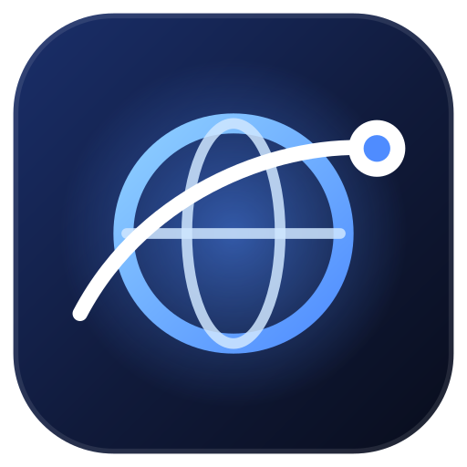
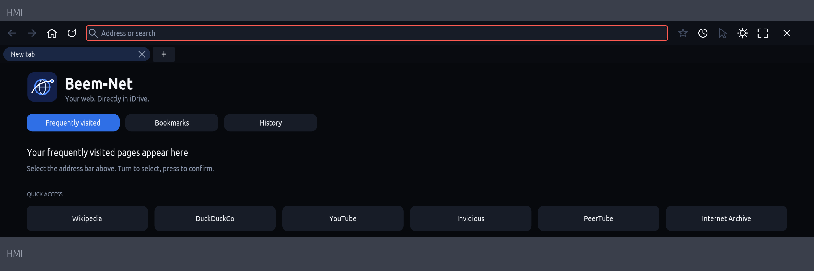
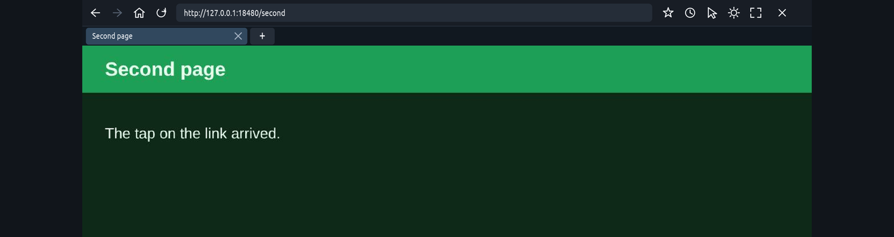
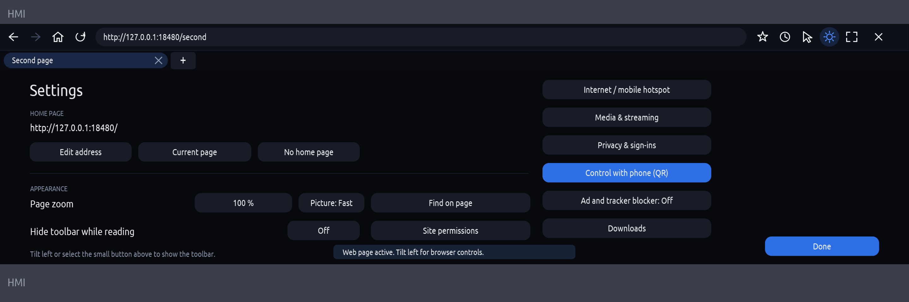

# Beem-Net

An internet browser for **BMW iDrive 7 and iDrive 8**, installed from the
[MGU Store](https://github.com/robertnisipeanu/mgu-store). A real Chromium runs on the head unit, out of sight; the
app shows its picture and sends it your touches.

> **Beta 3 (1.1.1), experimental.** Unofficial: not affiliated with or endorsed by BMW or Google. Use it parked.

| | |
|---|---|
|  |  |
| The start page | A page, the full width of the iDrive 8 screen |
|  |  |
| A tap on the page's link opened the next page | Settings: page zoom from 50 % to 150 %, picture Fast or Sharp |

These are not photos of a car. They are made on a computer by `test/id8/e2e_local.js`: the built app on a simulated
2880 x 960 iDrive 8 screen, the real backend and the real Chromium engine from the release, loading a demo page
from a local web server; the scroll and the tap in them were sent as touches.

## Where it stands

| Head unit | Tried on a car |
|---|---|
| **iDrive 8** | not yet: the open question is whether the engine runs there at all |
| **iDrive 7** | Beta 2 ran on the owner's car: pages, and YouTube with picture and sound through the car's speakers, but slow and with timeout messages. Beta 3 is the answer to that and has not been on a car yet |

New in Beta 3:

- **Faster.** The engine draws and decodes everything on the processor, so the app asks for less of it: video sites
  are offered H.264 up to 30 frames a second instead of VP9 / AV1 / 60 fps (several times the decoding work), the
  page's picture is 960 px wide instead of 1280 unless you choose **Picture: Sharp** in Settings (the page keeps its
  layout either way), pages are told to reduce motion, and the picture is sent a little more compressed.
- **Quiet when busy.** A slow answer from the engine is said once a minute as "The page is busy ...", not as a
  timeout message each time.
- **Full width on iDrive 8**: the bar and the page use the whole screen between BMW's status bar and climate bar.
- **Page zoom below 100 %**: 50, 67, 75, 90, 100, 125, 150 %.
- **English everywhere** in the app when the car is not set to German. (The phone remote's web page is still
  German.)
- A logo, a start page and a calmer dark design.
- **Open video sites on the start page** (1.1.1): Invidious (an open-source front end to YouTube; the tile opens
  one public instance - if it is down, pick another from <https://instances.invidious.io/> and bookmark it),
  PeerTube (through Sepia Search) and the Internet Archive's films, next to Wikipedia, DuckDuckGo and YouTube.

Still true: video is shown as pictures of the page, so it will not be as smooth as an app made for video
([BeeMTube2](https://github.com/waliworld/iDrive8-RideTube) is that app for YouTube on iDrive 8). Netflix, Disney+
and the like do not play: no DRM module is shipped.

The previous release is kept as [`beta2`](https://github.com/waliworld/Beem-Net/releases/tag/beta2).

## Install

1. In the MGU Store, add the source **`waliworld/Beem-Net`** and choose **Releases**.
2. Install **Beem-Net**. The Store installs what it needs with it: the Beem-Net service, the Chromium engine (about
   170 MB - give it time and a good connection), the Store's internet uplink and the GPU renderer.
3. Restart the head unit, then open **Beem-Net**.

If it does not open a page, a photo of what the screen says is what helps.

## What is different from upstream

- **The app** is built with the public app kit at the version that knows iDrive 8 - it makes one package with
  each unit's screen description - and places its page for the iDrive 8 screen too
  ([src/browser_layout.js](src/browser_layout.js)); on iDrive 7 the placement is upstream's.
- **The service** is upstream's published 0.16.1 package with its native parts byte for byte; the JavaScript files
  that differ from upstream's are the ones in this repository's [src/](src/) and [runtime/](runtime/) (the release
  tool lists them as it builds): the lighter video and picture, any zoom, the English texts, and how the app's uid is
  found on a unit where MainApp keeps no `uids.txt`. It carries Beem-Net's own version, 1.1.1.
- **The engine** is upstream's published Chromium package, byte for byte.
- Both carry `"mguHmi": ["ID7", "ID8"]`: upstream's say iDrive 7 only, which the installer refuses on iDrive 8.

[tools/release.py](tools/release.py) puts the release together and checks every upstream file against its
sha256 on the way.

## Good to know

- It is a browser on a car's head unit. It runs as its own unprivileged user inside Chromium's sandbox, but it has
  had no outside security review (upstream says so too, in [SECURITY.md](SECURITY.md)). Do not sign in to anything
  you would mind losing.
- Upstream can keep passwords and has a phone remote. Both are off unless you turn them on in its settings; leave
  them off on a customer's car.
- The package ids are upstream's (`mgu_browser`, `mgu-browser`, `mgu-browser-engine`), so the service and the app
  recognise each other. **On an iDrive 7 car use this source or upstream's, not both**: the two publish packages
  under the same names.

## Build and test on a computer

    git clone https://github.com/cauliflowermossgrape/idrive7-apps.git kit-checkout
    git -C kit-checkout checkout f54fc279d309ca12eba129b676d755c6f02f5a06
    node --test test/*.test.js test/id8/*.test.js
    python3 tools/release.py --kit kit-checkout        # dist/release/

`tools/build_store.py` refuses to run as root.

**End to end** (the real engine): unpack the engine package to `/var/opt/mgu-browser-engine/versions/0.1.0/` (its
Chromium is linked to that path), start `dev/backend.js` as an unprivileged user as upstream's
[development notes](docs/DEVELOPMENT.md) describe, then
`node test/id8/e2e_local.js <stage of build_store.py --keep-stage> <the backend's socket>`. It checks that a page
arrives as a picture, that a finger scrolls it and that a tap on a link opens the next page.

## Credits and licence

- **MGU Browser** by Leon Pllana and contributors - the browser. MIT.
- **idrive7-apps** by cauliflowermossgrape and contributors - the app kit. MIT.
- **MGU Store** by robertnisipeanu - how it is installed.
- The iDrive 7 + iDrive 8 release by **Waliworld #tunedbywali**.

MIT, see [LICENSE](LICENSE); third-party notices in [THIRD_PARTY_NOTICES.md](THIRD_PARTY_NOTICES.md) and
[licenses/](licenses/).
