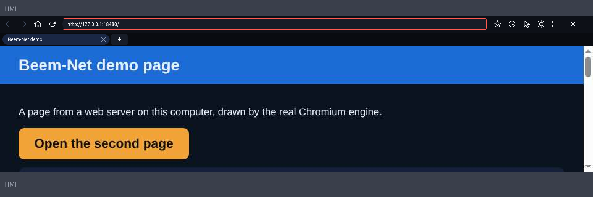
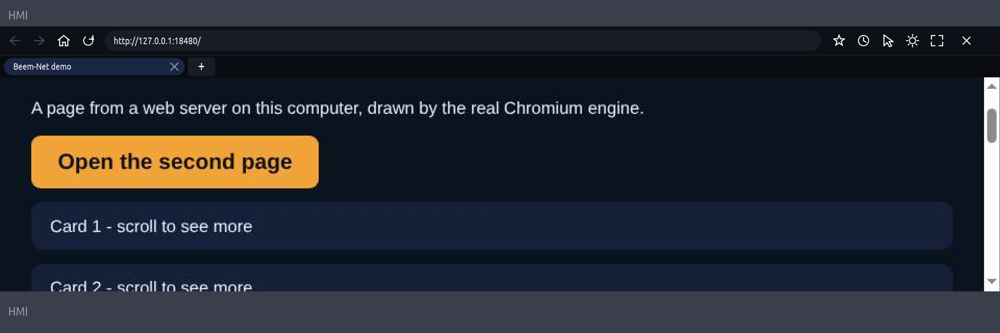

# Beem-Net

An internet browser for **BMW iDrive 7 and iDrive 8**, installed from the
[MGU Store](https://github.com/robertnisipeanu/mgu-store). A real Chromium runs on the head unit, out of sight; the
app shows its picture and sends it your touches.

> **Beta 2 (1.0.0), experimental, not confirmed on a car yet.** It is published so it can be tried on one. Unofficial: not
> affiliated with or endorsed by BMW or Google. Use it parked.

Beem-Net is **[MGU Browser](https://github.com/pllanaio/mgu-browser) by Leon Pllana**, which is written for
iDrive 7, made to install on iDrive 8 as well: one source, one app package, both head units. The browser itself - the Chromium engine, the service behind the app, the tabs, forms,
downloads and the rest - is his work, MIT licensed, and is credited in [CREDITS.md](CREDITS.md). His own
documentation is kept under [docs/](docs/) ([English overview](docs/UPSTREAM_README.en.md),
[German](docs/UPSTREAM_README.de.md)).

| | |
|---|---|
|  |  |
| A page in Beem-Net on the iDrive 8 screen: the bar, the tabs, the page | Scrolled with a finger |
|  | |
| A tap on the page's link opened the next page | |

These are not photos of a car. They are made on a computer by `test/id8/e2e_local.js`: the built app on a simulated
2880 x 960 iDrive 8 screen, the real backend and the real Chromium engine from the release, loading a demo page
from a local web server; the scroll and the tap in them were sent as touches. A photo from a car will replace them.

## Where it stands

| Head unit | What you get | Tried on a car |
|---|---|---|
| **iDrive 8** | the page's picture and touch (below) | not yet: the open question is whether the engine runs there at all |
| **iDrive 7** | MGU Browser 0.16.1 as its author published it - the same service and engine files - with the app built on the newer app kit | upstream's own build runs on its author's iDrive 7 unit; this build with the newer kit has not been tried |

On iDrive 8:

| | |
|---|---|
| In it | The app on the iDrive 8 screen (2880 x 960: the page under BMW's status bar and over the climate bar), touch on the page (tap, scroll), the address bar and the on-screen keyboard, tabs, bookmarks and history as upstream has them |
| Not yet | **Sound.** Upstream's way to the car's speakers is an iDrive 7 one. **Smooth video**: pages are shown as pictures, which is fine for reading and slow for video |
| Never, as it stands | Netflix, Disney+ and the like: no DRM module is shipped |

## Install

1. In the MGU Store, add the source **`waliworld/Beem-Net`** and choose **Releases**.
2. Install **Beem-Net**. The Store installs what it needs with it: the Beem-Net runtime, the Chromium engine (about
   170 MB - give it time and a good connection), the Store's internet uplink and the GPU renderer.
3. Restart the head unit, then open **Beem-Net**.

If it does not open a page, a photo of what the screen says is what helps.

## What is different from upstream

- **The app** is built with the public app kit at the version that knows iDrive 8 - it makes one package with
  each unit's screen description - and places its page for the iDrive 8 screen too
  ([src/browser_layout.js](src/browser_layout.js)); on iDrive 7 the placement is upstream's.
- **The runtime** is upstream's published 0.16.1 package, byte for byte, but for one file: how the app's uid is found
  on a unit where MainApp keeps no `uids.txt` ([runtime/setup.js](runtime/setup.js); where there is one, as on
  iDrive 7, it is read as before). It carries Beem-Net's own version, 1.0.0.
- **The engine** is upstream's published Chromium package, byte for byte.
- Both carry `"mguHmi": ["ID7", "ID8"]`: upstream's say iDrive 7 only, which the installer refuses on iDrive 8.

[tools/release.py](tools/release.py) puts the release together and checks every upstream file against its
sha256 on the way.

## Good to know

- It is a browser on a car's head unit. It runs as its own unprivileged user inside Chromium's sandbox, but it has
  had no outside security review (upstream says so too, in [SECURITY.md](SECURITY.md)). Do not sign in to anything
  you would mind losing.
- Upstream can keep passwords and has a phone remote. Both are off unless you turn them on in its settings; leave
  them off on a customer's car.
- The package ids are upstream's (`mgu_browser`, `mgu-browser`, `mgu-browser-engine`), so the service and the app
  recognise each other. **On an iDrive 7 car use this source or upstream's, not both**: the two publish packages
  under the same names.

## Build and test on a computer

    git clone https://github.com/cauliflowermossgrape/idrive7-apps.git kit-checkout
    git -C kit-checkout checkout f54fc279d309ca12eba129b676d755c6f02f5a06
    node --test test/*.test.js test/id8/*.test.js
    python3 tools/release.py --kit kit-checkout        # dist/release/

`tools/build_store.py` refuses to run as root.

**End to end** (the real engine): unpack the engine package to `/var/opt/mgu-browser-engine/versions/0.1.0/` (its
Chromium is linked to that path), start `dev/backend.js` as an unprivileged user as upstream's
[development notes](docs/DEVELOPMENT.md) describe, then
`node test/id8/e2e_local.js <stage of build_store.py --keep-stage> <the backend's socket>`. It checks that a page
arrives as a picture, that a finger scrolls it and that a tap on a link opens the next page.

## Credits and licence

- **MGU Browser** by Leon Pllana and contributors - the browser. MIT.
- **idrive7-apps** by cauliflowermossgrape and contributors - the app kit. MIT.
- **MGU Store** by robertnisipeanu - how it is installed.
- The iDrive 7 + iDrive 8 release by **Waliworld #tunedbywali**.

MIT, see [LICENSE](LICENSE); third-party notices in [THIRD_PARTY_NOTICES.md](THIRD_PARTY_NOTICES.md) and
[licenses/](licenses/).
